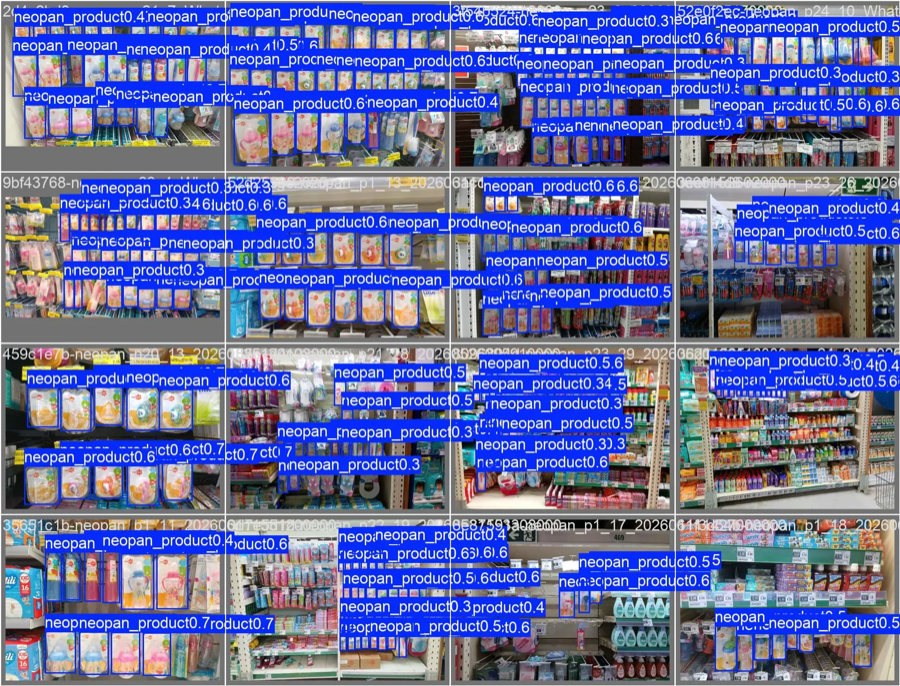
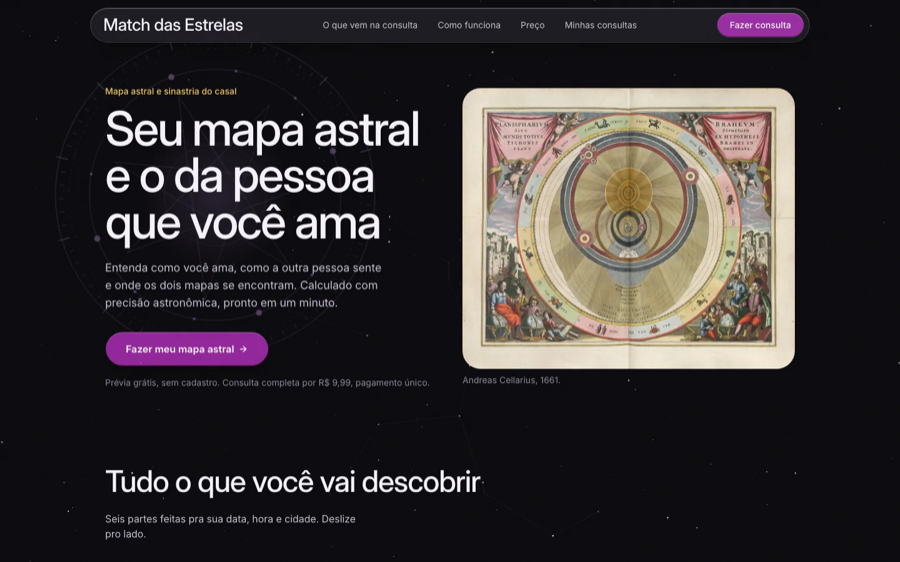

# Ryan Antunes

**Arquiteto de soluções · IA aplicada e visão computacional** · Aracaju, SE

Levo IA e automação do protótipo para a operação real: apps de campo, painéis, automações e visão computacional, do primeiro desenho até produção.

### Projetos em produção

| | |
|---|---|
|  | **Gôndola.ai** Visão computacional (YOLO) que transforma foto de prateleira em dado: produtos contados, rupturas e share de marca. |
|  | **Rota de Campo** App offline e painel de gestão usados por 200+ promotores em campo: visitas, PDVs, cobertura e ponto. |
|  | **Niino** Plataforma para restaurantes (cardápio, pedidos, clientes, financeiro) com assistente de IA que opera o sistema por conversa. |
|  | **Farmácia em Dia** Gestão de farmácia com estoque, pedidos e delivery pelo celular. |
|  | **Match das Estrelas** Produto próprio com pagamento online: mapa astral e sinastria com IA. |

Também construí um **Auditor de Fotos IA**: pipeline que valida 800+ fotos por dia, e só as exceções vão para um humano.

### Stack
`Python` `YOLO` `ONNX` `LLMs` `TypeScript` `React` `Node` `PHP/Laravel` `SQL` `Linux` `Docker` `Cloudflare`

### Onde me achar
[antunovisk.com.br](https://antunovisk.com.br) · [LinkedIn](https://www.linkedin.com/in/ryan-antunes-212b013a9/)

> A maior parte do meu trabalho é para clientes e fica em repositórios privados. Os públicos aqui são estudos e experimentos.
