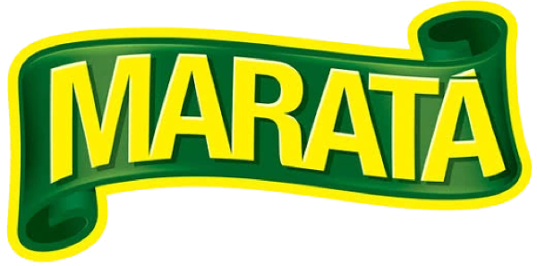
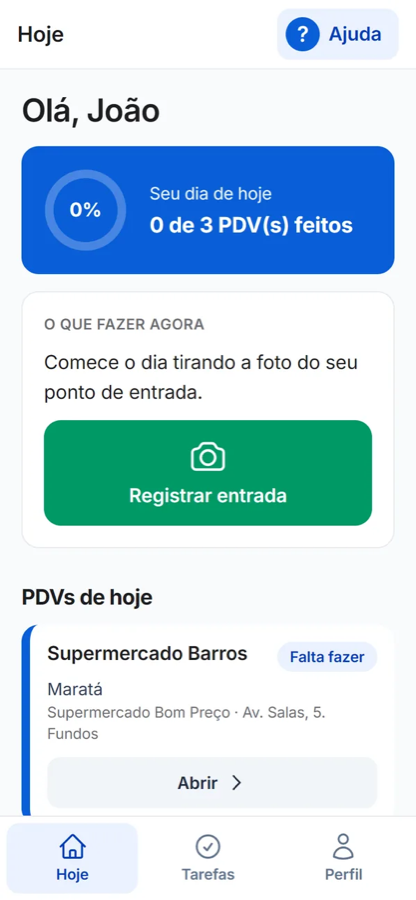
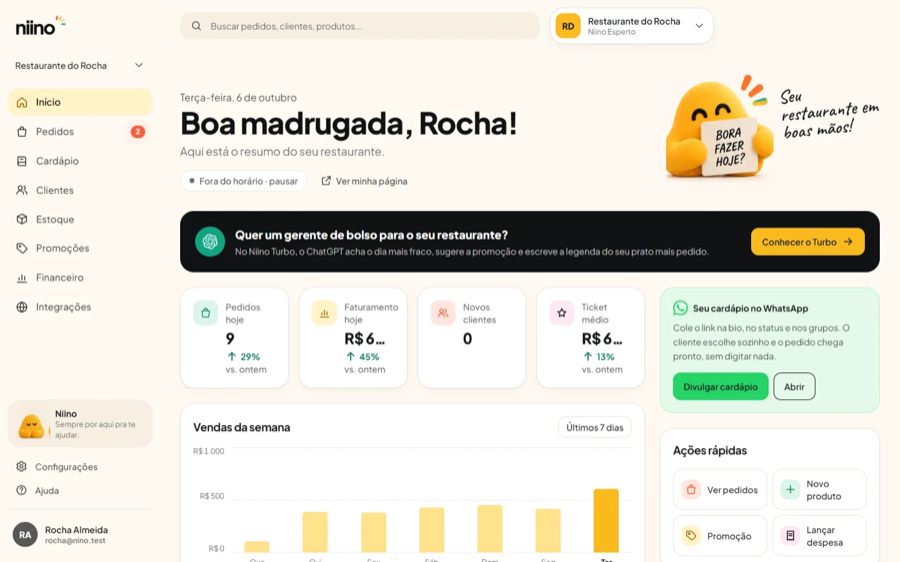
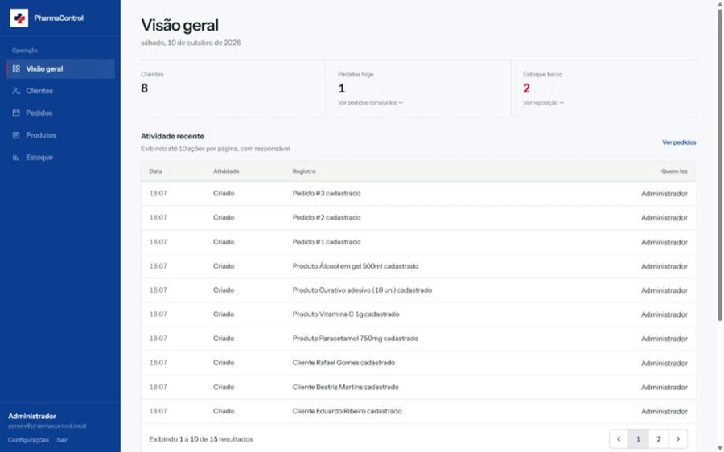

# Ryan Antunes

**Arquitetura de Software · Infra & DevOps · IA/ML (Visão Computacional, LLMs)** · Aracaju, SE

Projeto e opero sistemas de ponta a ponta: arquitetura, servidores Linux, containers, CI/CD, bancos de dados e modelos de IA em produção. Do primeiro desenho ao monitoramento.

<b>Sistemas de campo e IA em operação para a Maratá</b>

### Projetos em produção

| | |
|---|---|
|  | **Gôndola.ai** Visão computacional (YOLO) que transforma foto de prateleira em dado: produtos contados, rupturas e share de marca. |
|  | **Rota de Campo** App offline e painel de gestão usados por 150+ promotores em campo: visitas, PDVs, cobertura e ponto. |
|  | **Niino** Plataforma para restaurantes (cardápio, pedidos, clientes, financeiro) com assistente de IA que opera o sistema por conversa. |
|  | **Farmácia em Dia** Gestão de farmácia com estoque, pedidos e delivery pelo celular. |
|  | **Match das Estrelas** Produto próprio com pagamento online: mapa astral e sinastria com IA. |

Também construí um **Auditor de Fotos IA**: pipeline que valida 800+ fotos por dia, e só as exceções vão para um humano.

### Stack
**Infra & DevOps:** `Linux` `Docker` `Nginx` `Cloudflare (Workers, Tunnels)` `AWS` `CI/CD` `Homelab`  
**IA/ML:** `Python` `YOLO` `ONNX` `LLMs` `RAG` `Pipelines de visão`  
**Back & Front:** `TypeScript` `Node` `React` `PHP/Laravel` `Postgres` `MySQL` `SQLite`

<!--old `Python` `YOLO` `ONNX` `LLMs` `TypeScript` `React` `Node` `PHP/Laravel` `SQL` `Linux` `Docker` `Cloudflare` -->

### Formação
- Engenharia de Software · UniAmérica Descomplica (em andamento)
- Análise e Desenvolvimento de Sistemas · SENAI (2025)

### Onde me achar
[antunovisk.com.br](https://antunovisk.com.br) · [LinkedIn](https://www.linkedin.com/in/ryan-antunes-212b013a9/)

> A maior parte do meu trabalho é para clientes e fica em repositórios privados. Os públicos aqui são estudos e experimentos.
